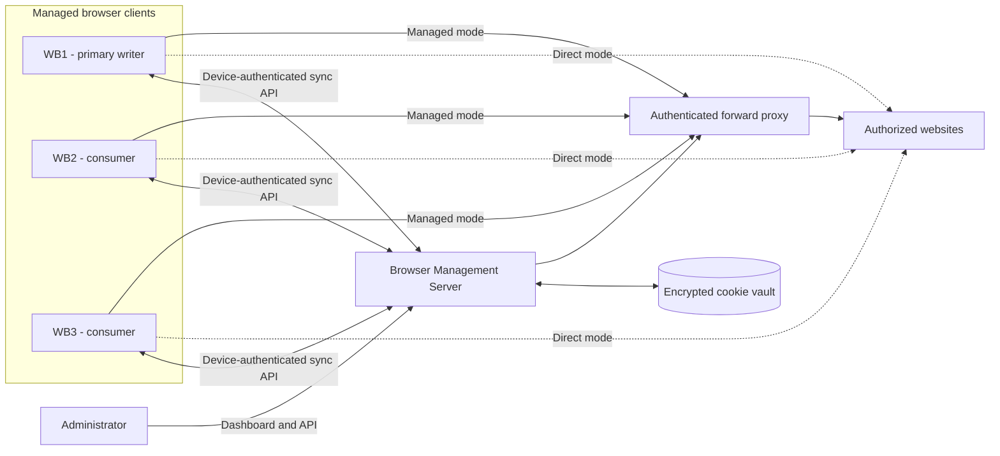
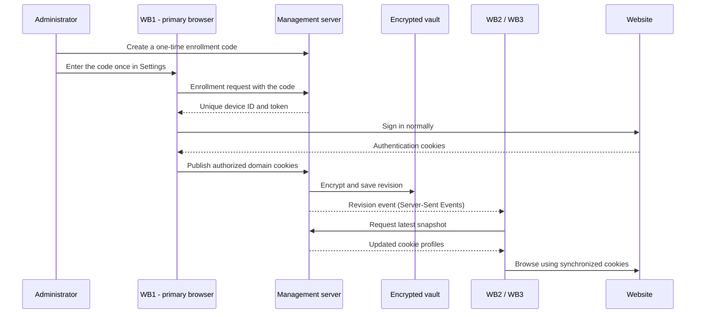

# Shared Browser System

Shared Browser is a centrally managed browser system for synchronizing authorized cookie-based sessions across multiple browser profiles. Each browser independently connects to the management server, while website traffic can either connect directly or use the server's authenticated forward proxy.

## Architecture



The management API and website route are separate. Synchronization always goes through the management server. Each browser independently chooses whether website requests use its own IP or the management server's IP.

## Session synchronization flow



The primary-writer model prevents a logged-out secondary browser from replacing a valid shared session. The server pushes each new revision to connected browsers over Server-Sent Events, so secondary browsers pick up a change within about a second; polling remains as a fallback.

## Included

- `server/` — ASP.NET Core management server and web dashboard
- `electron-client/` — cross-platform Shared Browser for Windows, macOS, and Linux
- Encrypted server-side cookie/session vault
- Unique device identities and revocable device tokens, enrolled with one-time codes
- Automatic per-domain cookie/session profiles
- A primary browser that publishes session changes while other browsers consume them
- Controlled cookie synchronization with one primary writer
- Shared home-page, address-bar search, and bookmark configuration
- Offline encrypted browser cache
- Browser/device status in the management dashboard
- Authenticated forward proxy built into the management server
- Per-browser choice between direct client-IP traffic and management-server-IP traffic
- TLS between browsers and the proxy, with the certificate pinned by the browsers
- Per-profile access: share a domain with all browsers or only selected ones
- Live updates over Server-Sent Events
- Audit log, automatic vault backups, and vault export/import
- Announcements from the administrator to all or selected browsers

Session values are sensitive credentials. Use this only for domains and accounts you own or are explicitly authorized to administer.

## Use cases

### Operate one authorized account from several computers

Sign in on WB1 and let WB2/WB3 receive the same cookie-based session. This is useful for an authorized support desk, operations team, test lab, or a single user moving between managed computers.

### Keep session synchronization separate from network routing

One browser can use Direct mode while another uses Managed proxy mode. Both can consume the same authorized cookie vault even though websites see different source IP addresses.

### Give websites a consistent server IP

Use Managed proxy mode when an authorized site should see the VPS outbound IP instead of each client's home, office, or mobile IP. Each browser authenticates to the proxy with its enrolled device credentials.

### Reduce accidental IP leaks

Strict Privacy mode requires the managed proxy, blocks direct fallback, restricts non-proxied WebRTC UDP, removes implicit Chromium proxy bypasses, and denies website permission prompts. It reduces leaks but does not conceal signed-in accounts or browser fingerprints.

### Centrally revoke a lost or retired browser

Revoke a device from the dashboard. A revoked device can no longer download or publish shared session data, its proxy credentials stop authorizing new connections, and proxy tunnels it already has open are closed within a few seconds. Retired browsers can also be deleted from the device list.

## What is synchronized?

| Browser data | Synchronized | Notes |
| --- | --- | --- |
| Regular cookies | Yes | Restricted to authorized domain profiles |
| Secure and HttpOnly cookies | Yes | Values are encrypted in the server vault |
| Cookie-based login sessions | Yes | Works when the website's login state is cookie-based |
| Cookie expiration dates | Yes | Expired cookies are dropped from the vault |
| Sign-outs and deleted cookies | Yes | Cookies the primary browser no longer holds are removed from the vault and from the other browsers |
| Shared bookmarks | Yes | Managed in the dashboard and shown in the client's ★ menu |
| Open tabs and window position | No | Restored per profile on the same computer |
| `localStorage` | No | Some sites may still require a new login |
| `sessionStorage` | No | Intentionally tab-scoped and temporary |
| IndexedDB and service-worker caches | No | Remain local to each browser profile |
| Passwords, passkeys, and payment data | No | Deliberately outside the synchronization boundary |

## Typical workflow

1. Deploy the management server and securely save its administrator token and data key.
2. Enable the forward proxy only if browsers need the server's outbound IP.
3. Install Shared Browser on each computer and give every instance a unique profile name.
4. Create a one-time enrollment code in the dashboard for each browser and enter it in the browser's Settings; the server issues a revocable device token in exchange.
5. Select WB1 as the primary session browser in the dashboard.
6. Sign in to an authorized website on WB1.
7. Open the same website on WB2 or WB3 after synchronization completes.
8. Choose Direct, Managed proxy, or Strict Privacy independently on each browser.

## Docker deployment on Linux

Docker is the recommended server deployment. The image uses the .NET 8 non-root `app` user, stores the encrypted vault in a named volume, binds the dashboard to localhost by default, and includes an optional Caddy HTTPS profile.

On the Linux server:

```bash
git clone https://github.com/un4ckn0wl3z/Shared-Browser-Server.git
cd Shared-Browser-Server
cp .env.example .env
```

Generate two independent secrets and place them in `.env`:

```bash
openssl rand -hex 48
openssl rand -hex 48
chmod 600 .env
```

Do not change `SHARED_BROWSER_DATA_KEY` after the vault contains data. Without the original key, stored sessions cannot be decrypted.

Build and start the server:

```bash
docker compose up -d --build
docker compose ps
docker compose logs -f shared-browser
```

Verify it locally:

```bash
curl http://127.0.0.1:8787/healthz
```

The default bindings are intentionally local-only:

- Dashboard/API: `127.0.0.1:8787`
- Forward proxy: `127.0.0.1:8899`

For HTTPS, point the DNS record in `SHARED_BROWSER_DOMAIN` at the server and start the optional Caddy profile:

```bash
docker compose --profile https up -d
```

Caddy publishes ports 80 and 443 and forwards only the management dashboard/API to the server container. Browser clients should then use `https://browser.example.com` as their management-server URL.

To allow remote browsers to use Managed proxy mode, set `SHARED_BROWSER_PROXY_PUBLISH_IP` in `.env` to the Linux server's private or VPN interface address, recreate the container, and configure the same address as the advertised proxy host in the dashboard:

```bash
docker compose up -d
```

The bundled Caddy profile streams the browsers' live-update connection (`/api/client/events`, Server-Sent Events) without extra configuration. Behind another reverse proxy, turn off response buffering for that path (for nginx: `proxy_buffering off;` and a `proxy_read_timeout` above 30 seconds); otherwise browsers fall back to polling every 30 seconds.

Turn on **Encrypt the browser-to-proxy connection with TLS** in the dashboard so the device credentials browsers send to the proxy are never readable on the network (see [Proxy TLS](#proxy-tls)). Even with TLS, prefer keeping port `8899` behind a private network, firewall allowlist, WireGuard, or Tailscale. If the dashboard proxy port is changed from `8899`, update the Compose port mapping at the same time.

The server keeps hourly backups of the vault in the `backups` folder of the data volume (see [Backups, export and import](#backups-export-and-import)). Still back up the `shared-browser-data` volume and securely retain the matching data key. Upgrade with:

```bash
git pull
docker compose up -d --build
```

### Upgrading

- The server reads vaults written by earlier versions as they are; there is nothing to migrate. Settings added later start with the previous behavior: profiles and announcements go to all browsers, the administrator token still enrolls browsers, and proxy TLS is off.
- Older browsers keep working against a newer server. They do not show announcements, keep polling instead of receiving live updates, and (before 1.1) do not remove cookies from profiles they lose access to.
- Update every browser that uses Managed proxy mode to 1.2 or newer before turning on proxy TLS.
- Restarting the server briefly interrupts open proxy connections; browsers reconnect and resume syncing on their own.

## Start the server

PowerShell:

```powershell
$env:SHARED_BROWSER_ADMIN_TOKEN = 'choose-a-long-random-administrator-token'
$env:SHARED_BROWSER_DATA_KEY = 'choose-a-different-long-random-encryption-key'
$env:ASPNETCORE_URLS = 'http://127.0.0.1:8787'
$env:SHARED_BROWSER_PROXY_BIND = '127.0.0.1'
dotnet run --project server\SharedBrowser.Server.csproj -c Release
```

Open `http://127.0.0.1:8787` and enter the administrator token.

For browsers on other computers, bind the server to an appropriate private network interface and put HTTPS in front of it. Do not transmit device tokens or session cookies over untrusted plain HTTP.

### Server configuration

| Variable | Purpose |
| --- | --- |
| `SHARED_BROWSER_ADMIN_TOKEN` | Required. Dashboard administrator token (and, unless disabled, an enrollment credential). |
| `SHARED_BROWSER_DATA_KEY` | Required. Encrypts cookie values in the vault, backups and exports. Never change it once data exists. |
| `SHARED_BROWSER_DATA` | Data directory (`state.json`, `audit.jsonl`, `backups/`, `proxy-tls.pfx`). |
| `SHARED_BROWSER_PROXY_BIND` | Interface the forward proxy listens on (default `127.0.0.1`). |
| `SHARED_BROWSER_PROXY_TLS_CERT` / `SHARED_BROWSER_PROXY_TLS_KEY` | Optional PEM certificate and key for proxy TLS. Without them the server generates a self-signed certificate. |
| `SHARED_BROWSER_BACKUP_INTERVAL_MINUTES` | Minimum time between automatic backups (default `60`). |
| `SHARED_BROWSER_BACKUP_KEEP` | Number of backups to keep (default `48`). |
| `SHARED_BROWSER_TRUST_FORWARDED_HEADERS` | `true` to take client addresses in the audit log from `X-Forwarded-For`. Enable only when the server is reachable solely through a reverse proxy such as the bundled Caddy profile. |

`SHARED_BROWSER_PROXY_BIND` controls the interface used by the built-in forward proxy. Keep `127.0.0.1` for a local-only installation. For clients on a private network, set it to the server's private interface (or `0.0.0.0`) and protect the port with a firewall. The proxy always requires an active enrolled-device ID and device token; it is not an open unauthenticated proxy.

## Shared Browser client (Electron)

The client runs on Windows, macOS, and Linux.

Ready-to-use installers are published on the [GitHub Releases page](https://github.com/un4ckn0wl3z/Shared-Browser-Server/releases): a Windows x64 NSIS installer, a universal macOS DMG, and a Linux x64 AppImage, each built on a native GitHub runner. These community builds are currently unsigned, so Windows SmartScreen or macOS Gatekeeper may display a warning; review the repository source before allowing an unsigned build.

Install and start it with Node.js 20 or newer and pnpm (`corepack enable` provides it):

```bash
cd electron-client
pnpm install
pnpm start --profile=WB1
```

Use a different profile name for every browser instance:

```bash
pnpm start --profile=WB2
pnpm start --profile=WB3
```

On Windows, `Open-WB1.cmd`, `Open-WB2.cmd`, and `Open-WB3.cmd` in the repository root start the WB1, WB2, and WB3 profiles after the dependencies are installed.

On Linux, make the AppImage executable and pass the profile name the same way (`chmod +x Shared-Browser-*.AppImage`, then `./Shared-Browser-1.2.0-linux-x86_64.AppImage --profile=WB1`). AppImages need FUSE; on Ubuntu 22.04 and newer install `libfuse2` (`libfuse2t64` on 24.04). Started from the AppImage, the client updates itself.

Each profile name gets its own browser storage, device identity, encrypted device token, and offline cache. All profiles connect to the same management server and shared vault.

On first launch, the settings dialog opens automatically. In the dashboard, use **Connect a browser** to create a one-time enrollment code (it expires after 10 minutes by default and works once). In the browser, enter the management-server URL, a device name such as `WB1`, and the enrollment code, then choose Direct or Managed proxy mode. Saving restarts and enrolls the client, and the server issues a random per-device token.

The administrator token also works as an enrollment credential for compatibility. Turn off **Allow browsers to enroll with the administrator token** in the dashboard once every browser uses codes, so the administrator token never has to be typed on a browser computer.

Repeat enrollment for WB2 and WB3. In the dashboard, choose the signed-in browser (normally WB1) as **Primary session browser**. Its stored cookies are published on startup, and every domain whose cookies it holds is added to the shared vault automatically. WB2 and WB3 receive each change within about a second over the live event stream; if it is unavailable they poll every 2.5 seconds instead.

The installed client checks GitHub Releases at startup and every four hours. Its version is shown in the window title, the toolbar status text, and the settings dialog, which also has **Check for updates**. Windows and Linux AppImage builds download a new release in the background and show **Restart to update** in the toolbar; the update otherwise installs when the browser is closed. The macOS DMG is unsigned, so macOS cannot install updates in place: the toolbar shows **Update to vX** and opens the release page. Update checks follow the browser's connection mode, so in Managed or Strict privacy mode they go through the management proxy.

The address bar accepts full URLs, bare host names (`github.com`, or `localhost:3000` which opens over HTTP), and search terms, which use the search URL configured in the dashboard (DuckDuckGo by default; leave it empty to disable searching). The ★ button lists the shared bookmarks; hold Ctrl (⌘) or Shift to open one in a new tab. Middle-click a tab to close it, and double-click the empty tab strip to open a new one. Download progress is shown in the status text.

Keyboard shortcuts (⌘ instead of Ctrl on macOS): Ctrl+T new tab, Ctrl+Shift+T reopen the last closed tab, Ctrl+W close tab, Ctrl+Tab / Ctrl+Shift+Tab switch tabs, Ctrl+L focus the address bar, Ctrl+F or F3 find in page (Enter / Shift+Enter for next and previous, Esc to close), Ctrl+R or F5 reload, Ctrl+Shift+R hard reload, Alt+← / Alt+→ back and forward, Ctrl+= / Ctrl+- / Ctrl+0 zoom, and F12 developer tools. Right-click a page for copy/paste, link, and Inspect actions. Links that open a new tab load as tabs; `window.open` popups open as real windows so sign-in and approval flows that report back to their opener keep working.

Open tabs and the window size and position are restored the next time a profile starts. Tab addresses are stored encrypted along with the device credentials.

Electron stores each named profile in the operating system's application-data directory. Device credentials and the offline shared snapshot use Electron `safeStorage`; Chromium protects its persistent cookie store using the facilities available on the operating system. On Linux, install and unlock a supported secret store such as KWallet, GNOME Keyring, or Secret Service. The client warns when Electron falls back to unencrypted `basic_text` storage.

Create platform installers from the matching operating system:

```bash
pnpm run dist:win
pnpm run dist:mac
pnpm run dist:linux
```

macOS installers normally must be built and code-signed on macOS. Windows installers should be signed before public distribution.

## Direct IP or management-server IP

The dashboard's **Forward proxy management** section controls the built-in proxy endpoint, advertised host, port, allowed destination ports, and browser bypass list.

Each browser independently chooses its route in **Server settings**:

- **Direct connection — use client IP**: websites connect directly and see the browser computer's public IP.
- **Managed proxy — use server IP**: HTTP and HTTPS traffic goes through the authenticated management-server proxy, so websites see the management server's outbound IP.
- **Strict privacy**: requires Managed proxy mode, removes Chromium's implicit direct bypass routes, blocks browsing if the proxy configuration is unavailable, restricts WebRTC from using non-proxied UDP, and denies website permission prompts such as location, camera, microphone, and notifications.

Restart a browser after changing its connection mode. When an administrator changes the proxy endpoint in the dashboard, browsers in Managed mode switch to it on their next sync without a restart. HTTPS uses standard `CONNECT` tunneling and remains end-to-end encrypted between the browser and destination; the management proxy does not install a certificate authority or decrypt page contents.

Strict privacy is leak reduction, not anonymity. Signed-in accounts, shared cookies, browser fingerprints, and account activity can still identify a user. Because WebRTC cannot use direct UDP in this mode, browser-based voice or video calls may fall back to TCP or fail.

The settings dialog includes **Run privacy check**, which verifies that Chromium resolves both public and loopback destinations through the configured proxy and confirms that the non-proxied WebRTC policy was applied. Run it after saving and restarting the browser.

### Proxy TLS

Browsers authenticate to the proxy with their device ID and token. With **Encrypt the browser-to-proxy connection with TLS** enabled in the dashboard, the proxy accepts only TLS connections and browsers in Managed mode switch to an `https://` proxy automatically, so those credentials and the requested destinations are never sent in plain text.

The server generates a self-signed certificate on first use and keeps it in the data directory, or uses `SHARED_BROWSER_PROXY_TLS_CERT` and `SHARED_BROWSER_PROXY_TLS_KEY` when set (a renewed certificate on disk is picked up within a minute). Browsers do not rely on a public certificate authority: the management server publishes the certificate's SHA-256 fingerprint over its authenticated API, the dashboard shows it, and each browser accepts the proxy certificate only when it matches.

Proxy TLS requires Shared Browser 1.2 or newer on every browser that uses Managed mode. Update the browsers before turning it on; older browsers cannot connect to a TLS proxy.

Plain-HTTP requests through the proxy are answered with `Connection: close`, so a browser never reuses the connection for a second request that the proxy would pass to the first origin unparsed.

The default destination-port allowlist is `80,443`. To reduce server-side request-forgery risk, the proxy refuses private, loopback, link-local (including cloud metadata), carrier-grade NAT (`100.64.0.0/10`), documentation and benchmarking ranges, multicast and reserved addresses, and IPv6 NAT64 or 6to4 addresses that embed any of those.

A tunnel stays open as long as data flows and closes after 10 minutes without traffic, so long downloads and WebSockets are not cut off. The proxy accepts up to 2048 simultaneous connections, gives up on destinations that do not answer within 20 seconds (502), and closes a revoked browser's open tunnels within about 5 seconds.

## Synchronization rules

- Automatic sharing is enabled by default. The primary browser creates a profile for every domain whose cookies it publishes.
- Only the primary browser can publish cookie/session changes. This prevents a logged-out secondary browser from overwriting a logged-in session.
- The primary browser publishes a complete cookie list per domain, and only for domains whose cookies changed. Cookies it no longer has (for example after signing out) are removed from the vault. A cookie typed into the dashboard is protected until the primary browser has received it; after that it is removed on sign-out like any other cookie. Secondary browsers delete a removed cookie only while it still holds the value they received.
- A disabled profile stops sharing for its domain; the primary browser does not recreate an automatic profile for it.
- Profile edits in the dashboard keep stored cookie values when the value field is left empty, so one cookie can be changed without re-entering the others.
- The server announces every new revision over Server-Sent Events, and browsers pull the snapshot immediately. Polling remains as a safety net (every 30 seconds while the event stream is connected, every 2.5 seconds otherwise): browsers send the revision they already have and the server answers `204 No Content` when nothing changed. After errors, polling backs off up to one minute.
- Profiles can still be disabled or removed from the dashboard when a domain should not be shared. Tick several profiles and use **Delete selected**, or **Purge all** (confirmed by typing `PURGE`) to empty the vault; both save a backup first, so either can be undone under **Vault backups**. Other browsers remove the deleted cookies, while the primary browser keeps its own and, with automatic sharing on, shares a domain again the next time its cookies there change.
- A profile can be shared with all browsers or only selected ones. A browser that loses access removes the cookies it received from that profile, and deleting the last selected browser never widens a profile to everyone.
- Server revisions provide a consistent order across browsers.
- Cookie conflicts use server-arrival last-write-wins behavior.
- Identical updates are deduplicated and do not create new revisions.
- A revoked browser can no longer pull or push shared data.
- In Direct mode, browser web traffic does not pass through the management server. In Managed mode, it passes through the authenticated forward proxy.

The first version deliberately uses the central server as the authority. Direct P2P transport can be added later without changing the browser data model.

## Administration

### Browsers

The dashboard's **Managed browsers** table shows each enrolled browser, when it was last seen, and a **LIVE** badge while it holds the live event stream. **Revoke** stops a browser from syncing or using the proxy (and closes its open proxy tunnels) but keeps its record so it can be restored; **Delete** removes it, and it must enroll again with a new code to reconnect. The primary session browser is marked **PRIMARY**.

### Announcements

The dashboard's **Send an announcement** section sends a message to every browser or to selected ones. An announcement has a title and/or message, a level (info, warning, or critical), an optional link, and an optional expiry (1 hour to 30 days, or never). Connected browsers show it within a second or two as a banner below the toolbar, and the page moves down so nothing is covered. Warning and critical announcements also raise a desktop notification.

The banner is plain text: nothing in an announcement is interpreted as HTML. **Open link** opens the link in a new tab, and **×** dismisses the banner on that browser. The dismissal is remembered across restarts and reported to the server, so the dashboard lists which browsers have dismissed each announcement. Deleting an announcement removes its banner everywhere; expired announcements disappear from browsers and stay listed in the dashboard for a week.

### Audit log

The dashboard's **Activity** section lists enrollments, enrollment codes, settings and proxy changes, announcements, profile changes and bulk deletions, bookmark and device changes, vault exports, imports and restores, and failed administrator sign-ins or enrollments (at most one entry per address every five minutes). Entries are also written to `audit.jsonl` in the data directory and to the server log. Set `SHARED_BROWSER_TRUST_FORWARDED_HEADERS=true` behind a reverse proxy so the recorded address is the client's rather than the proxy's.

### Backups, export and import

The server copies `state.json` into `backups/` at most once an hour (`SHARED_BROWSER_BACKUP_INTERVAL_MINUTES`) and keeps the newest 48 (`SHARED_BROWSER_BACKUP_KEEP`). The dashboard's **Vault backups** section lists them and restores any of them, and can export the current vault or import an exported one. Every import or restore first saves the current vault as another backup.

Backups and exports keep cookie values encrypted with `SHARED_BROWSER_DATA_KEY`, so they can only be restored on a server with the same data key; a vault written with another key is refused. They do contain device token hashes and enrollment state, so store them as carefully as the data volume.

## Development and tests

Integration tests start the real server and real Electron browsers:

```bash
dotnet build server/SharedBrowser.Server.csproj -c Release
cd electron-client && pnpm install && cd ..
cd tests && pnpm install
pnpm exec playwright install chromium
xvfb-run -a pnpm test
```

`pnpm run test:server`, `pnpm run test:dashboard`, and `pnpm run test:electron` run one suite at a time. On a desktop, run `pnpm test` without `xvfb-run`. The proxy tunnel tests need an origin on an address the proxy treats as public; they are skipped unless `TEST_PUBLIC_IP` (default `8.8.4.4`) is bound locally, for example with `sudo ip addr add 8.8.4.4/32 dev lo` on Linux. The CI workflow runs the whole suite on every pull request.

## Releasing

1. Bump `version` in `electron-client/package.json` and merge it to `main`.
2. In GitHub Actions, run **Desktop release** with `release_tag` set to the new tag (for example `v1.3.0`), or push that tag.
3. The workflow builds the Windows installer, the macOS DMG, and the Linux AppImage on native runners, creates the GitHub release with generated notes, and uploads the installers together with `latest.yml` and `latest-linux.yml`, which installed Windows and Linux clients use to update themselves.

Running the workflow without `release_tag` only builds the installers and keeps them as workflow artifacts for 30 days. Redeploy the server separately (see [Docker deployment on Linux](#docker-deployment-on-linux)).
